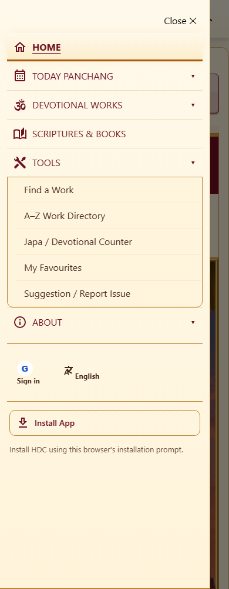

# Approved HDC header staging review

Owner-supplied gateway/path design-board implementation. These are local staging
screenshots, not evidence of deployment or physical-device app installation.
Baseline: `f290e1d`. Latest upstream artwork/library changes are retained.

| View | Before | After |
| --- | --- | --- |
| Desktop |  |  |
| Mobile |  |  |

The menu screenshot uses a synthetic browser installation offer to make the ready
state reproducible. It does not claim an OS installation occurred. See
`HDC_HEADER_STAGING.md` for test results, source-image limits and rollback steps.
Do not merge/deploy before explicit staging approval.
