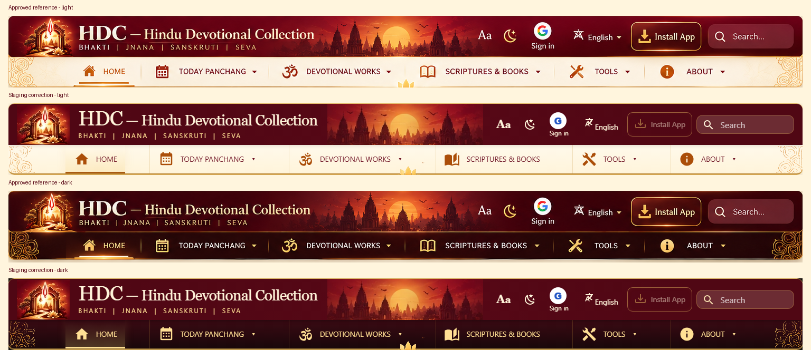

# Header visual-correction review

Native-resolution strips from the owner's actual PNG and the corrected staging
screenshots, aligned at 1536px viewport width. The staging Install App control is
accurately disabled when this browser has no installation offer; it is not styled
as a fake successful installation.

| View | Before (deployed PR 39) | Correction |
| --- | --- | --- |
| Desktop |  |  |
| Mobile |  |  |

The existing hero artwork/content are retained intentionally. The duplicate
search/navigation stack above the hero is removed; search remains in the hero
and header, and every auxiliary destination remains available below it.
See `HEADER_VISUAL_CORRECTION.md` for preservation scope, tests and rollback.
